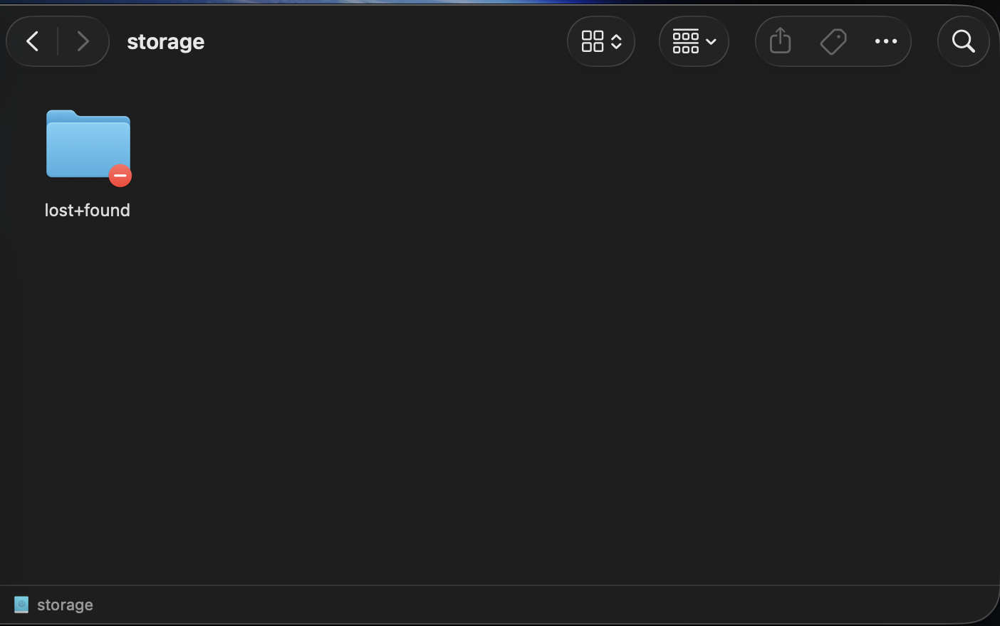

# Setup the Samba service in the Mac Mini Home Server 

Installing the Samba service to the Mac Mini. The machine I am trying to turn it into a home server. It is not only will run as a storage, but also it might be the web server and having other computer lab experiments. Link to the [MyMacMini-2012-Restoration](https://github.com/martin-marzzz/MyMacMini-2012-Restoration).

## What to do? 

As usual, ran the update command on the Linux machine.

Then install the Samba service.

```bash
sudo apt update
sudo apt install samba 
```

It needs to setup the password for the access to the Samba service in the home lab as the security concerns.

```bash
sudo smbpasswd -a [username]
```

Insert the `[storage]` section to the config file.

There are things that need to clarify, what are the two masks?

`create mask = 0664` : the new file when **created**, given the permission is 0664
- owner: r + w 
- group: r + w 
- others: r 

`directory mack = 0775` : the new folders when **created**, given the permission is 0775
- owner: r + w + enter (Here is not exe since it means the people can access/enter to the folder.) 
- group: r + w + enter
- others: r + enter

4 (Read) + 2 (write) + 1(execute) = 7

```bash
sudo nano /etc/samba/smb.conf
```

```nano
[storage]
   path = /mnt/storage
   browseable = yes
   read only = no
   valid users = [username]
   create mask = 0664
   directory mask = 0775
```

Then restarting the service, and check the service is up and running.

```bash
sudo systemctl restart smbd
sudo systemctl enable smbd

sudo systemctl status smbd --no-pager
```

So now the Samba service should be up and running when the **active (running)**.

But there is the ufw setting is missing from it. It needs to allow the Samba port open to allow the traffic.

Then check the Samba is listening to make sure the port is ON.

```bash
sudo ufw status

sudo ufw allow Samba
sudo ufw reload

sudo ss -tlnp | grep -E '445|139'
```

After the configuration, then using any devices to access the Samba service on the **Server** with the IP address with `storage`.

```txt 
smb://[server-IP-address]/storage
```

The connection is working!!



But now has the permission issue I found.

I wanted to test the function on the storage by creating and editing a test file from **Client** side. Here is the permission issue encountered. 

The ownership on the `/mnt/storage` on the **server** side need to be fixed.

It crowns the marting login can create file in the `storage`.

**On Server**
```bash
sudo chown -R martin:martin /mnt/storage
sudo chmod -R u+rwX,g+rwX /mnt/storage
```

So now the creation of new file is working. Also the storage dir on **Server** can be store files.

